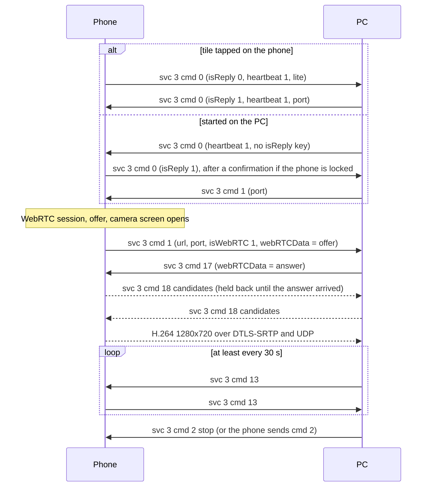

# Webcam (service 3)

**Status in this project:** Implemented. The daemon advertises service 3 (so the phone shows its
Webcam tile) and a helper, `smartconnect-webcam`, implements both start paths and serves the
phone's camera as a v4l2loopback device or a PipeWire camera node. **Verified with a phone:** a live
session, and switching between the front and back camera mid-session. Also covered by unit tests
for every message shape and a test pattern through the PipeWire output. Not verified: the quality
presets' effect on the phone's encoder, pause/resume (not used), rotation. Pause/resume and the
extra controls of Motorola's dedicated camera app are not implemented.

**Implementation:** [`webcam/src/main.rs`](../../webcam/src/main.rs) (the helper),
[`webcam/src/proto.rs`](../../webcam/src/proto.rs) (messages),
[`webcam/src/output.rs`](../../webcam/src/output.rs) (output device choice),
[`src/webcam.rs`](../../src/webcam.rs) and [`src/helpers.rs`](../../src/helpers.rs) (the daemon
starts the helper when the phone asks).

## Overview

The phone's camera becomes a PC webcam (OBSERVED, phone app and the Windows app):

- Signalling is plain service 3 JSON on the control channel.
- **Media is WebRTC.** The phone is the offerer and sends one H.264 video track, 1280x720 at 30 fps,
  with no audio. The phone's session builder always builds a WebRTC session; the SRTP-looking fields
  in its start message are leftovers of an older mode.
- Either side can start (the phone's Webcam tile, or "start webcam" on the PC) and either side can
  stop. The PC must send a heartbeat at least every 30 s.
- **`/readyfor/webcam` is not for the phone.** On Windows it is a WebSocket on the PC's local web
  server that accepts only loopback peers and feeds preview frames to the Windows app's own UI. The
  phone app never uses such a path. A Linux PC does not need it.

## Gates

- **Tile:** `"3"` in the verify reply's `serviceVersions` (Windows sends `3`) **and** `"3"` in the
  PC's service 25 `cap` map (see [device-status-and-tiles.md](device-status-and-tiles.md))
  (OBSERVED).
- **Before the phone sends its request** it checks that it runs as the main user, that a hardware
  encoder is free for 1280x720 at 30 fps, that the link is not a cloud relay, and that no webcam
  session is already active. On failure it shows a toast and sends nothing (OBSERVED, phone app).
- **For a PC-initiated request** the phone checks the main user, admin policy (error 5) and a free
  encoder (error 9); if another PC holds the webcam it answers error 1. If the phone is on and
  unlocked it accepts at once; if it is locked or the screen is off, it shows a confirmation screen
  and sends the PC a service 8 notice ("accept on your phone"); declining gives error 6 or 7
  (OBSERVED, phone app).

## Message shape

Every payload is `{"ver": "1", "cmd": N, "data": {…}}` in the normal envelope (OBSERVED):

- The phone's tile request arrives with `srcServiceId: 19`, `serviceId: 3`. PC messages with
  `srcServiceId: 3` work.
- The phone sends its camera replies and camera status as a **JSON string** in `data` (for
  example `"data": "{\"ver\":1,\"cmd\":5,…}"`). Parse `data` again when it is a string.
- SDP and ICE candidates travel as **JSON strings** in `data.webRTCData`.

## Commands

| cmd | Direction | Name | `data` | Tag |
|---|---|---|---|---|
| 0 | phone → PC | Request (tile tapped) | `{minL: 1, maxL: 1, heartbeat: 1, isReply: 0, lite: 0 or 1}` | OBSERVED |
| 0 | PC → phone | Reply to the phone's request | `{isReply: 1, heartbeat: 1, port: <n>, …}`. `isReply: 1` with a `port` starts the camera; `isReply: 0` cancels. | OBSERVED |
| 0 | PC → phone | PC-initiated request | `{heartbeat: 1, …}` with **no `isReply` key at all**: the phone checks whether the key is present. | OBSERVED |
| 0 | phone → PC | The phone accepts a PC request | `{minL: 1, maxL: 1, heartbeat: 1, isReply: 1, lite}` | OBSERVED |
| 1 | PC → phone | Start, after the phone accepted a PC request | `{port: <n>}`. Without `data` the phone cancels. | OBSERVED |
| 1 | phone → PC | Stream started, carries the offer | Start data, see below | OBSERVED |
| 2 | both | Stop | none | OBSERVED |
| 3 | PC → phone | Query cameras | none; reply `{ver: "1", cmd: 3, data: [{cameraId: <facing>}]}` | OBSERVED |
| 4 | PC → phone | Switch front and back camera | none; reply: status (`cmd 5`) | OBSERVED |
| 5 | phone → PC | Camera status | See below. Sent as the reply to `cmd 4`, `7` and `9` and whenever the camera state changes. | OBSERVED |
| 7 | PC → phone | Toggle the torch ("studio light") | none; reply: status | OBSERVED |
| 9 | PC → phone | Zoom | `{state: <level>}`, 0 to `zoom.max`; reply: status | OBSERVED |
| 11 | PC → phone | Pause | none | OBSERVED |
| 12 | PC → phone | Resume | `{port: <n>}` | OBSERVED |
| 13 | PC → phone | Heartbeat | none; the phone answers with its own `cmd 13` | OBSERVED |
| 17 | PC → phone | WebRTC answer | `{sessionId, type: "answer", webRTCData: "{\"type\":\"answer\",\"sdp\":\"…\"}"}` | OBSERVED |
| 18 | both | ICE candidate | `{sessionId, type: "candidate", webRTCData: "{\"type\":\"candidate\",\"label\":<m-line index>,\"id\":\"<mid>\",\"candidate\":\"candidate:…\"}"}` | OBSERVED |
| 65535 | both | Error | `{code, cmd}` (below) | OBSERVED |

Any other command that reaches the phone during a session is passed to its camera screen; the
camera screen's reply (or, if it has none, the current status) goes back to the PC (OBSERVED).

Notes (OBSERVED, phone app):

- `port`: in WebRTC mode the phone only stores the PC's port and echoes it in its start message;
  ICE decides where media goes. The phone's own default is 6466.
- `heartbeat: 1` in the PC's `cmd 0` turns on the phone's heartbeat watchdog. Without it the phone
  never times out a silent PC.
- The phone does not check `sessionId` in the PC's `cmd 17` and `18`. In its own `cmd 18` it puts
  its stream id (a millisecond timestamp with three random digits appended).
- `lite` is 1 when the phone uses its simpler in-app camera screen, and 0 when Motorola's dedicated
  desktop-camera app is installed.

## Main flows



### Stop and timeouts (OBSERVED, phone app)

- A PC `cmd 2` stops the stream and closes the camera screen. The phone does **not** send `cmd 2`
  back.
- When the user stops on the phone, the camera screen closes, or a phone-side error occurs, the
  phone sends `cmd 2`.
- No PC `cmd 13` for 30 s: the phone tears the session down and sends `cmd 2`.
- No "connected" state within 60 s of the request: the phone gives up.
- Losing the control connection ends the phone's session through its normal failure handling
  (INFERRED).
- The PC can pause (`cmd 11`) and resume (`cmd 12`); Windows probably does this when no application
  has its virtual camera open (INFERRED).

## Start data (phone `cmd 1`)

```json
{
  "ver": "1",
  "cmd": 1,
  "data": {
    "prefix": "srtp://",
    "url": "192.168.1.35",
    "port": 6466,
    "w": 0,
    "h": 0,
    "cameraId": 0,
    "key": "",
    "mediaFormat": 0,
    "isWebRTC": 1,
    "isVideoDump": 0,
    "webRTCData": "{\"sdp\":\"v=0…\",\"type\":\"offer\"}"
  }
}
```

- `url` is the phone's own address on the link the control channel uses. It is useful for choosing
  which local ICE candidates to offer (OBSERVED).
- `prefix`, `key`, `w`, `h`, `mediaFormat` (and a parameter-set field) belong to the older direct-SRTP
  mode; in this version `key` is empty and the session is always WebRTC (OBSERVED).
- The phone sends this message only once its camera screen reports that streaming started; the
  offer, created at session setup, is already inside (OBSERVED).

### WebRTC details

The phone uses the same peer-connection client as [app streaming](mirroring.md#webrtc-details)
(OBSERVED, phone app):

- Unified Plan, max-bundle, rtcp-mux required, ECDSA certificate, no ICE servers (host candidates
  only), TCP candidates disabled, continual gathering.
- One video track; no receive video and no audio. The offer may also carry the client's data channel.
- Codec "H264 Baseline". H.265 is preferred only when a hidden setting and a debug flag are both on;
  trimming the offer to H.264 is still the safe choice.
- Capture and encoding at 1280x720, 30 fps; bitrate up to about 8000 kbit/s (INFERRED from the
  quality defaults). The camera screen rotates and letterboxes the image into the 1280x720 encoder
  surface itself.
- The phone holds back its own candidates until it has applied the answer, then sends them all. It
  reads the PC's candidates as `{id: <mid>, label: <m-line index>, candidate}`.

## Camera status (`cmd 5`)

```json
{
  "ver": 1,
  "cmd": 5,
  "data": {
    "cameraId": 0,
    "flash": { "ability": 1, "state": 0 },
    "zoom": { "ability": 1, "state": 0, "max": 8 },
    "angle": { "ability": 0, "state": 0, "states": 0 },
    "mute": { "ability": 0, "state": 0 },
    "tracking": { "ability": 0, "state": 0, "sensitivity": 0, "size": 0 }
  }
}
```

- `cameraId` is the Android lens facing: 0 front, 1 back. The first session uses the phone's saved
  choice, front by default (OBSERVED).
- The in-app camera supports `flash` (torch) and `zoom`; `angle`, `mute` and `tracking` always report
  `ability: 0`. The Windows app also knows `blur` and `mute_loop`; Motorola's dedicated camera app
  may support more (OBSERVED for the in-app camera, INFERRED for the other).
- Switching between front and back resets zoom to 0 (OBSERVED).

## Error codes (`cmd 65535`, `data: {code, cmd}`)

Phone → PC (OBSERVED, phone app):

| code | Meaning |
|---|---|
| 1 | The webcam is in use by another PC |
| 5 | Disabled by device policy |
| 6, 7 | The user declined on the confirmation screen (6 = an explicit user action) |
| 8 | Not the phone's main user |
| 9 | No free hardware encoder for 1280x720 at 30 fps |
| 10 | The camera is already open in another app |

PC → phone, acted on when `data.cmd` is 0 or 1 (OBSERVED, phone app):

| code | Phone reaction |
|---|---|
| 1 | Toast "in use", stop |
| 12 | Dialog asking the user to install the PC's camera driver, stop |
| other | Stop |

## This project

- The daemon advertises `serviceVersions["3"] = 3` and service 25 `cap["3"] = 1`, relays service 3
  to the helper, and starts `smartconnect-webcam --answer` when the phone asks (`cmd 0` with
  `isReply: 0`) and no session is running. If the helper cannot be started, it answers error 12, so
  the phone shows its "install the driver" dialog.
- The helper answers with `webrtcbin`, trims the offer to H.264 and drops the video-orientation
  extension, decodes, and converts to a fixed 1280x720 YUY2 30 fps stream. It writes to a
  v4l2loopback device (only devices under `/sys/devices/virtual`, so a real camera is never
  overwritten) or, without one, offers a PipeWire `Video/Source` node with the camera role.
- It sends `cmd 13` every 10 s and offers only UDP IPv4 candidates on the phone's /24 (taken from the
  start message's `url`).

## Pitfalls

1. **`isReply` must be absent** in a PC-initiated `cmd 0`; the phone tells request and reply apart by
   the key's presence, not its value (OBSERVED, phone app).
2. **Heartbeat.** Send `cmd 13` well inside 30 s, or the phone stops the camera.
3. **String payloads.** Camera replies arrive with `data` as a JSON string.
4. **Candidates.** The phone disables TCP and would try every address offered; offer only UDP host
   candidates on the phone's network.
5. **GStreamer:** `pipewiresink` in provide mode needs `use-bufferpool=false`; with its buffer pool
   the pipeline stalls after two frames until a consumer attaches (OBSERVED in this project with a test
   pattern).
6. **v4l2loopback** keeps one format while an application has the device open, so convert to a
   fixed size, format and rate. With `exclusive_caps=1` the device appears as a camera only while
   frames flow; start the webcam before opening the application that uses it.

## Open questions

- What Windows puts in its `cmd 0` reply and `cmd 1` beyond `isReply`, `heartbeat` and `port`
  (its JSON tags include `capture_enable`, `loop_enable`, `sensitivity`, `size`, `state`); the
  in-app camera ignores them.
- When exactly Windows pauses and resumes.
- The commands of Motorola's dedicated desktop-camera app (angle, tracking, blur, mute).
- There is no PC → phone resolution command in the in-app camera path; 1280x720 is fixed.
