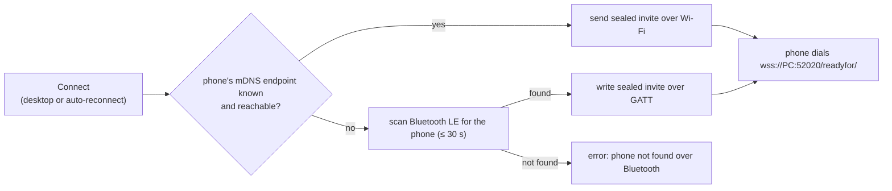

# Usage

Status keys used on this page, the same as in the [README](../README.md#feature-status):
✅ verified on a real phone · 🟡 implemented, not verified on a phone yet · ❌ not supported

- [Ways to drive it](#ways-to-drive-it)
- [Running the daemon](#running-the-daemon)
- [Pairing](#pairing)
- [Connecting and disconnecting](#connecting-and-disconnecting)
- [Tray icon and background running](#tray-icon-and-background-running)
- Features: [phone status](#phone-status) · [clipboard](#clipboard) · [notifications](#notifications) ·
  [SMS](#sms) · [screen mirroring](#screen-mirroring) · [app streaming](#app-streaming) ·
  [Screen share and Mobile desktop](#screen-share-and-mobile-desktop-tiles) ·
  [Cross Control](#cross-control) · [feature tiles](#feature-tiles-on-the-phone) · [PC lock](#pc-lock) ·
  [Hotspot](#hotspot) · [phone as display](#phone-as-an-external-display) · [webcam](#phone-as-a-webcam) ·
  [phone files](#browsing-the-phones-files) · [sharing a PC folder](#sharing-a-pc-folder-to-the-phone-phone-browses-the-pc) ·
  [not supported](#not-supported)
- [Command-line reference](#command-line-reference): [`smartconnectd`](#smartconnectd) ·
  [`smartconnect-mirror`](#smartconnect-mirror) · [`smartconnect-crosscontrol`](#smartconnect-crosscontrol) ·
  [`smartconnect-display`](#smartconnect-display) · [`smartconnect-webcam`](#smartconnect-webcam) ·
  [`smartconnect-files`](#smartconnect-files) · [`smartconnect-fex`](#smartconnect-fex) · [`smartconnect-gui`](#smartconnect-gui) · [Noctalia IPC](#noctalia-ipc) ·
  [environment variables](#environment-variables) · [files](#files)

## Ways to drive it

| Front-end | What it can do |
|---|---|
| The Smart Connect app on the phone | Pair (scan the QR), Connect, Disconnect, and the tiles on the PC's device page (App streaming, Cross Control, PC lock, Hotspot, Webcam). Starting the PC's screen on the phone. |
| GTK app (`smartconnect-gui`, **Smart Connect** in the app launcher) | A header **device menu** (left of the title) shows the connected device and holds *Pair new phone…*, *Preferences* (the *Start at login* switch) and *Connect/Disconnect*. A view switcher has five pages. *Phone*: a phone card (wallpaper, name, an inline battery / Wi-Fi / mobile / Bluetooth row, and **Mirror screen**), an unread-messages shortcut, and a Cross Control switch with an edge picker. While the phone is away the card keeps showing the last connected phone (dimmed last-known values, "last connected …") with a **Connect** button; with no phone paired it offers **Pair a phone**. If the Smart Connect service isn't running, the window says so, shows the last phone, and has a **Start service** button. *Apps*: a search box, Recent chips and an icon grid to stream single phone apps. *Display*: the phone as a second monitor or a copy of your screen (Layout / Experimental / Advanced groups). *Files*: mount the phone's storage, quick-folder shortcuts, and storage settings. *Notifications*: notifications grouped under *Today* with reply boxes, a ⋯ menu (*Open on phone*, *Dismiss*, *Mute app*) and per-app mute. Pairing opens in a dialog. In a narrow window the page switcher moves to the bottom. It also puts a [tray icon](#tray-icon-and-background-running) in the system tray and starts the daemon when you open it. |
| Noctalia plugin | Bar pill with battery level. Panel with the phone card (wallpaper, battery, signal, unread count), Connect/Disconnect, the pairing QR, Mirror screen, Cross Control with an edge selector, Phone as display with an Extend/Duplicate switch, a Phone files tile (mount, open, unmount), and recent notifications with reply boxes and mute buttons. Settings for the display, the phone files and the muted apps. An [IPC target](#noctalia-ipc) for keybindings. |
| CLI | `smartconnectd` with `status`, `subscribe`, `connect`, `disconnect` or `pair`, plus the helper programs. See the [reference](#command-line-reference). |
| Your own scripts | The [control socket API](control-socket-api.md). |

All desktop front-ends talk to the daemon over `$XDG_RUNTIME_DIR/smartconnectd.sock`, so they work
side by side.

## Running the daemon

Normally it runs as a systemd user service, which `packaging/install.sh --enable` sets up (see
[Installation](installation.md#the-systemd-user-service)):

```sh
systemctl --user enable --now smartconnectd
journalctl --user -u smartconnectd -f
```

For development or debugging, stop the service and run it in a terminal:

```sh
systemctl --user stop smartconnectd
RUST_LOG=debug smartconnectd --no-ble --name "Linux PC"
```

Started this way, it prints the pairing QR straight into the terminal. Two options exist for
protocol work and are off by default:

- `--session-log` records every frame exchanged with the phone in
  `~/.local/share/smartconnect-linux/sessions/`, with keys, tokens, passwords, clipboard, SMS and
  notification contents redacted (see [Security](security.md#session-logs)).
- `--extra-tiles SVC[=FLAGS],…` advertises extra feature tiles to the phone, for example
  `--extra-tiles 1` for [Screen share and Mobile desktop](#screen-share-and-mobile-desktop-tiles).

To keep the flags under systemd, add them with a drop-in (`systemctl --user edit smartconnectd`,
see [Installation](installation.md#the-systemd-user-service)).

## Pairing

Status: ✅

1. Make sure the firewall allows TCP 52020 and mDNS ([Installation](installation.md#firewall)).
2. Get a QR code:
   - **GTK app:** the header **device menu**, then **Pair new phone…** (opens a dialog with the QR; **New code** refreshes it).
   - **Noctalia:** the QR button at the top of the panel.
   - **CLI:** `smartconnectd pair`, then open the SVG it names:
     `xdg-open ~/.local/share/smartconnect-linux/pairing-qr.svg`. A daemon running in a terminal
     also prints the QR there. Under systemd the terminal QR goes to the journal
     (`journalctl --user -u smartconnectd -o cat -n 60`).
3. On the phone, open **Smart Connect**, tap **+**, choose **Scan QR code**, and scan it.
4. The phone connects, and the PC appears in its device list under the name from `--name` (the
   systemd unit uses `Linux PC`). Without `--name`, the hostname is used.

Things to know:

- A QR stays valid for `--token-ttl` seconds: 180 by default, 600 in the systemd unit. The daemon
  renders a fresh one when it expires, so an open QR window can go stale. Ask for a new one if a
  scan fails.
- The QR lists the PC's private IPv4 addresses. Docker, libvirt, VPN and similar interfaces are
  skipped. If the phone tries the wrong address, start the daemon with `--ip <address>` (repeat it
  for several).
- Right after the first pairing, the new device entry on the phone can show "offline" with a
  Connect button even though the session is up. That is the phone app's ordering, not a failure.
  About 5 s later the daemon asks the phone to reconnect, which fixes it, provided it has seen the
  phone's mDNS advert. Otherwise tap **Connect** once.
- **Pairing again** after removing the PC on the phone works the same way: scan a fresh QR. The
  daemon repeats the key exchange whenever the phone doesn't start it, so the entry comes back.
- **One phone at a time.** The daemon can store several paired phones, but connection state is
  shared, so only one phone is expected to be connected.
- **Unpairing:** remove the PC in the Smart Connect app. To make the PC forget the phone as well,
  stop the daemon and delete that phone's entry from `~/.local/share/smartconnect-linux/paired.json`,
  or reset everything with `./packaging/uninstall.sh --purge`. Deleting `cert.pem`/`key.pem` changes
  the PC's certificate fingerprint, and every paired phone then has to pair again.

## Connecting and disconnecting

Status: ✅ (Wi-Fi reconnect, Bluetooth LE wake, automatic reconnect)

**From the phone:** tap **Connect** or **Disconnect** on the PC's entry in Smart Connect. Connect
finds the PC over mDNS and asks it for an invite, then the phone dials the PC.

**From the desktop:** the Connect/Disconnect button in the GTK app or the Noctalia panel, or:

```sh
smartconnectd connect      # prints {"message":"…","ok":true|false}
smartconnectd disconnect
```

A desktop Connect first tries Wi-Fi: it pushes an encrypted invite to the phone's own discovery
endpoint, using the last address the phone advertised over mDNS. That endpoint only listens while
Smart Connect is open on the phone. If it fails, the daemon scans for the phone over Bluetooth LE
for up to 30 s, writes the same invite to it, and the phone then connects over Wi-Fi. This works
with the app in the background, and is how the genuine Windows PC does it: a backgrounded phone app
has no Wi-Fi listener at all and never reconnects to a PC by itself. It takes about 5 to 6 s.
Bluetooth must be on on both devices; the daemon never switches the PC's adapter on (or off) by
itself, and with Bluetooth off on the PC a backgrounded phone reconnects only when you open Smart
Connect on it. Only one Connect runs at a time: pressing the button while the daemon is already
reconnecting waits for that attempt. If a desktop Connect doesn't get through, the daemon keeps
trying in the background (below).



**Automatic reconnect.** If a session drops without a Disconnect, 8 s after the daemon starts, and
after a desktop Connect that didn't get through, the daemon keeps trying Connect until the phone is
back. It waits 2, 5, 15, 30 and 60 s between attempts and then every 5 minutes; while the phone
still answers on the LAN (Smart Connect merely in the background) it retries at least once a minute
for the first 15 attempts. It also tries straight away when:

- the phone's mDNS advert appears (Smart Connect opened on the phone);
- the phone answers on Wi-Fi again after being away (checked every 30 s with a single TCP
  connection attempt to its last address, no Bluetooth needed);
- this PC wakes from suspend, or gains a LAN address (Wi-Fi back, new network);
- Bluetooth is switched on on this PC.

The daemon follows the PC's LAN addresses, so invites carry the current ones after a network change
(unless `--ip` pins them). A session that goes silent for 70 s (the phone answers WebSocket pings
every 20 s) is treated as dead and dropped, which starts the reconnect loop; before, a phone that left
Wi-Fi could look connected for many minutes.

**Disconnect is respected.** After a Disconnect from either side, the daemon stops reconnecting on
its own. The next Connect from either side ends that state.

## Tray icon and background running

Status: 🟡 (implemented; needs a system-tray host, which the Noctalia/Quickshell bar provides).

The GTK app puts a StatusNotifierItem in the system tray. Its icon follows the state — daemon not
running, starting, phone disconnected, phone connected — and its tooltip spells it out. Left-click
shows or hides the window; right-click opens a menu with **Show/Hide Window**, **Connect**,
**Disconnect** and **Quit**.

- **Closing the window hides it to the tray** instead of quitting. The daemon and any streams keep
  running; reopen from the tray (or by launching the app again).
- **Opening the app starts the daemon** if it isn't already running. It prefers the
  `systemctl --user` unit when that is installed, otherwise it runs `smartconnectd` itself. The
  window shows *Starting smartconnectd…* until the control socket answers.
- **Quit** (tray menu only) leaves the app *and* stops the daemon — the systemd unit with
  `systemctl --user stop smartconnectd`, or the `smartconnectd` the app started as a child. A daemon
  you started by hand (e.g. in a terminal) is left running.
- **Start at login:** the switch on the *Phone* page adds or removes
  `~/.config/autostart/dev.smartconnect.Linux.desktop` (`Exec=smartconnect-gui --background`), so the
  app comes up at login hidden to the tray, with the daemon started. You can also run
  `smartconnect-gui --background` yourself.

If the desktop has no system-tray host, the app still runs with just its window (and the tray is
simply absent).

## Phone status

Status: 🟡

The phone pushes its battery level and charging state, Wi-Fi and mobile signal, Bluetooth state,
unread message count and wallpaper. The GTK app's *Phone* page and the Noctalia bar and panel show
them, and `smartconnectd status` prints them as JSON (field reference in the
[control socket API](control-socket-api.md#the-status-object)). They are kept in memory only. The
wallpaper is saved to `$XDG_RUNTIME_DIR/smartconnectd/phone-wallpaper.jpg` (or `.png`).

## Clipboard

Status: ✅ text both ways · ❌ images and files

- Copy text on the phone and it is placed on the Linux clipboard (`wl-copy`).
- Copy text on Linux and it is sent to the phone (`wl-paste --watch`).
- Copies that a password manager marks as sensitive are never sent to the phone.
- Text longer than 100,000 characters is cut to that length.
- When you copy files or screenshots on the phone, the daemon logs them as unsupported and ignores
  them.

This needs `WAYLAND_DISPLAY` in the daemon's environment and a compositor with the data-control
protocol (see [Troubleshooting](troubleshooting.md#clipboard-doesnt-sync)).

## Notifications

Status: ✅ mirrored to the desktop, quick reply, multi-line messages ·
🟡 action buttons, "Open on phone", dedupe/coalescing, themed icons, per-app mute

Notifications the phone forwards appear through your desktop notification daemon. They update in
place when the phone updates them and close when they are dismissed on the phone. The phone decides
which apps it forwards.

- **Multi-line messages:** for chat notifications the body shows up to the last 4 messages. In group
  conversations each line is prefixed with the sender. Bodies are cut at 600 characters.
- **Quick reply** (✅): if the app supports replies, the notification gets a **Reply** button (it is
  also the default click action). It opens a small reply window: type, press Enter to send, Esc to
  cancel. The GTK app's *Notifications* page and the Noctalia panel also show reply boxes under
  replyable notifications. The reply goes back through the app's own reply action on the phone.
- **Action buttons** such as "Mark as read" or a timer's "Pause" (🟡): the phone carries these out
  through app streaming. It asks the PC to stream the app and fires the action once the app is up
  on its own virtual display. The stream host (`smartconnect-mirror --host`, which the daemon keeps
  running) answers that request **without opening a window** and closes the stream again a few
  seconds later, after the phone reports that the app is up. Set
  `SMARTCONNECT_BACKGROUND_ACTIONS=0` in the daemon's environment to get a window instead.
- **Open on phone** (🟡): clicking a notification that can't be replied to — or *Open on phone* in the
  GTK app's **⋯** menu — opens that app in its own window on the PC through
  [app streaming](#app-streaming), as on Windows.
- **Dedupe and coalescing** (🟡): identical re-posts are dropped, and a notification that keeps
  changing (progress bars, timers, calls) updates the desktop at most once per second.
- **App icons** (🟡): the phone's own launcher icon from the app-icon cache
  (`~/.cache/smartconnect-linux/app-icons/`) when it has been downloaded, else an icon from your
  theme matching the app's name or package (searched in `~/.local/share/icons`, Papirus, hicolor,
  breeze, Adwaita), else the phone's monochrome glyph. Big pictures and callers' pictures appear as
  the notification image. Chat notifications (WhatsApp and similar) show the app icon: the phone
  sends only your own picture with them, never the sender's.
- **Per-app mute** (🟡): a muted app produces no desktop popups. Its notifications still appear in
  the GTK app and the Noctalia panel.
  - **GTK app:** a notification's **⋯** menu has *Mute app* (and *Unmute* once muted). The *Muted apps*
    list at the top of the *Notifications* page has an **Unmute** button per app.
  - **Noctalia:** the bell-off button on a notification in the panel (highlighted while muted), and
    *Settings → Muted apps* with **Unmute** buttons.
  - **Control socket:**

    ```sh
    S=$XDG_RUNTIME_DIR/smartconnectd.sock
    echo '{"cmd":"notif_mute","pkg":"com.example.app","mute":true}' | socat - UNIX-CONNECT:$S
    echo '{"cmd":"notif_mute","pkg":"com.example.app","mute":false}' | socat - UNIX-CONNECT:$S
    echo '{"cmd":"notif_mute"}' | socat - UNIX-CONNECT:$S          # list muted packages
    ```

  The list lives in the daemon (`~/.local/share/smartconnect-linux/notif-mute.json`), so every
  front-end shows the same one. The package name of each recent notification is the `pkg` field in
  `smartconnectd status`, and `smartconnect-mirror --list-apps` lists all apps.
- Notifications with custom layouts (some media players) carry no usable text and are skipped.

## SMS

Status: 🟡 backend only, needs enabling on the phone, not verified

There is no UI yet. Use the control socket commands `sms_threads`, `sms_thread`, `sms_send`,
`sms_mark_read` and `sms_state` (see the [API reference](control-socket-api.md#sms-commands)).

```sh
S=$XDG_RUNTIME_DIR/smartconnectd.sock
echo '{"cmd":"sms_threads"}' | socat - UNIX-CONNECT:$S      # starts a sync, returns what is cached
sleep 5
echo '{"cmd":"sms_threads"}' | socat - UNIX-CONNECT:$S      # conversations, newest first
echo '{"cmd":"sms_send","number":"+15555550123","text":"On my way"}' | socat - UNIX-CONNECT:$S
```

The phone only answers once Messages is enabled for this PC. The first sync sends the "PC ready"
message, which enables it once the phone allows it; Smart Connect also needs SMS permission on the
phone. `sms_state` shows the phone's answer in `usable` (`enabled`, `granted`). Messages are kept in
memory only and cover what the phone sends, about the last 10 days.

## Screen mirroring

Status: ✅ video and mouse input · 🟡 keyboard, phone keys and scrolling

Start it with:

- **GTK app:** *Phone* page, then **Mirror screen** (the button changes to **Stop mirroring**).
- **Noctalia:** **Mirror screen** in the panel.
- **CLI:** `smartconnect-mirror`. When a stream host is running (the daemon starts one after the
  phone connects), the viewer hands the request to the host and exits, and the window belongs to
  the host.

The phone may ask for permission to share its screen. The window is titled
"Phone — Smart Connect".

Input in the mirror window:

| On the PC | On the phone |
|---|---|
| Mouse move, left/right/middle button | Pointer and clicks at that spot |
| Mouse wheel | Scroll |
| Mouse "back" side button | Back |
| `Esc` | Back (`Shift+Esc` sends a real Escape) |
| `Ctrl+Alt+B` | Back |
| `Ctrl+Alt+H` | Home |
| `Ctrl+Alt+R` | Recents (app switcher) |
| Other keys (`Ctrl+C`/`V`/`A`, `Alt+Tab`, arrows, F-keys, …) | Sent as real key presses (PC scancodes, US layout) |

Super combinations are usually taken by your compositor. Keyboard input only works when the video
window runs under XWayland: the viewer uses X11 automatically when `DISPLAY` is set, because
GStreamer's native Wayland GL window gets no keyboard events.

To stop, close the window, use the Stop button, or press Ctrl+C in the terminal you started it from.
The session also ends if the connection to the phone is lost for more than 5 s.

The video goes directly between the phone and this PC over UDP. The PC offers the phone only the
address the phone already reached it on (the daemon's `pcAddress`), so Docker, VPN and other
interfaces aren't tried; set `SMARTCONNECT_ICE_ADDRESSES` to override that (see
[environment variables](#environment-variables)). Only H.264 is decoded (VA-API when available,
otherwise libav). See [Troubleshooting](troubleshooting.md#mirroring-and-app-streaming).

## App streaming

Status: ✅ apps started from the PC · 🟡 apps started from the phone's tile or the GTK app's *Apps*
page · 🟡 window resize

Each phone app opens in its own Linux window, titled after the app (for example
"Calculator — Phone"). On the phone, each streamed app runs on its own virtual display.

- **From the PC:**

  ```sh
  smartconnect-mirror --list-apps            # pkg, userId, name, component (tab-separated)
  smartconnect-mirror --app com.example.calculator
  smartconnect-mirror --sessions             # JSON list of open streams
  smartconnect-mirror --close <sessionId>
  ```

  `--app` goes through the stream host if one is running. Otherwise it streams from its own process
  and exits when its windows close.
- **GTK app:** *Apps* page. **Load Apps** fetches the list (cached in
  `~/.cache/smartconnect/apps.json`), search it, and click an app to open it. Running streams are
  listed with Close buttons. The page starts a stream host if none is running.
  - **App icons** (🟡): the page shows the phone's own icon when it is in
    `~/.cache/smartconnect-linux/app-icons/`. The daemon downloads all of them from the phone on
    every connection (✅ verified on a device; it takes about a second; `SMARTCONNECT_APP_ICONS=0`
    turns it off), and the stream host also saves the icon the phone sends with a stream. To
    download them now, run `smartconnect-fex fetch-app-icons`. Otherwise it uses a
    desktop icon only when one matches exactly (the package name, or an installed app with exactly the
    same name), and else the app's initials. New icons appear on their own; **Refresh** looks again.
    The same icons are used for Recent, running streams and notifications.
- **From the phone:** tap the **App streaming** tile on the PC's device page and pick an app on the
  phone. The daemon keeps a stream host (`smartconnect-mirror --host`) running while a phone is
  connected, and that host answers the phone's request.

Input in app windows uses the same code as the mirror window, but hasn't been verified separately.
Closing a window ends that app's stream. Window icons aren't set yet.

**Window resize** (🟡, opt-in): with `SMARTCONNECT_MIRROR_RESIZE=1` in the daemon's environment (or
a host started as `smartconnect-mirror --host --resize`), resizing an app window asks the phone to
resize that app's virtual display to match, once the new size has held for a moment. It is off by
default because tiling compositors resize every new window right away, so each app would ask the
phone for a new size as soon as it opens. The whole-screen mirror is never resized.

## Screen share and Mobile desktop tiles

Status: 🟡 implemented, not verified on a device; hidden by default

The phone has two more tiles for a PC: **Screen share** (the phone's screen, or a "virtual phone",
in a PC window) and **Mobile desktop** (Ready For's desktop mode in a PC window). The daemon only
advertises them when it runs with `--extra-tiles 1`:

```sh
systemctl --user edit smartconnectd     # ExecStart=… --extra-tiles 1, see Installation
```

Tapping a tile and then **Connect** on the phone makes the phone ask the PC to show that view; the
stream host answers, and the view opens in a window titled "Phone — Smart Connect",
"Virtual phone — Smart Connect" or "Mobile desktop — Smart Connect". The phone may ask you to
allow streaming first. The phone keeps the advertised tiles until the next connection made without
the flag.

From the PC, `smartconnect-mirror --desktop` asks the phone for the Mobile desktop view directly
(through the stream host when one runs).

## Cross Control

Status: ✅ started from the PC · 🟡 started from the phone's tile

Cross Control moves the PC's mouse and keyboard onto the phone, as if the phone sat next to your
screen.

1. Start it:
   - **GTK app:** the **Cross Control** switch on the *Phone* page. Pick the phone edge first.
   - **Noctalia:** **Cross Control** in the panel. The arrow button next to it cycles the edge.
   - **CLI:** `smartconnect-crosscontrol --edge right`
   - **Phone:** tap the **Cross Control** tile. If no client is running, the daemon starts
     `smartconnect-crosscontrol --edge "${SMARTCONNECT_CROSS_EDGE:-right}" --accept`.
2. Push the pointer into the chosen edge of the screen. The phone may ask you to allow control the
   first time.
3. Your mouse now moves a pointer on the phone, and your keyboard types on it. Where the compositor
   supports it, desktop shortcuts are inhibited while you control the phone.
4. To come back, push the pointer back out past the shared edge (with no button held), or press
   **Ctrl+Alt+Esc**. To enter again right away, give a small outward push inside the edge strip.
5. Stop the client with the same switch or button, or Ctrl+C. It tells the phone it is done.

Only one client runs at a time. Starting a new one takes over from the old one. Known gap: the GTK
switch and the Noctalia button show "off" while a client started by the daemon (from the phone's
tile) is running.

Needs `wlr-layer-shell`. Pointer constraints, relative pointer and shortcut inhibiting are used when
available. Tested only on niri. Options are listed in the
[reference](#smartconnect-crosscontrol).

## Feature tiles on the phone

Status: ✅

On connect, the daemon tells the phone which features this PC offers, and the phone draws tiles for
them on the PC's device page: **App streaming**, **Cross Control**, **PC lock**, **Hotspot** and
**Webcam**. **Screen share** and **Mobile desktop** are only offered with `--extra-tiles 1` (see
[above](#screen-share-and-mobile-desktop-tiles)). A tile only does something if its PC-side
handler is available:

| Tile | Handled by |
|---|---|
| App streaming | The stream host, which the daemon starts after the phone connects. |
| Cross Control | A running `smartconnect-crosscontrol`, or one the daemon starts on demand. |
| PC lock | The daemon (`loginctl lock-session`). |
| Hotspot | The daemon (`nmcli`). |
| Webcam | `smartconnect-webcam --answer`, which the daemon starts on demand. If it can't be started, the phone shows its "install the PC camera driver" message. |
| Screen share, Mobile desktop | The stream host (only with `--extra-tiles 1`). |

Showing the PC's screen on the phone isn't a tile on the device page, but the phone can start it
too; see [Started from the phone](#started-from-the-phone).

The stream host, Cross Control and the phone display are only started when the daemon has
`WAYLAND_DISPLAY` or `DISPLAY` in its environment. The webcam helper needs neither.

## PC lock

Status: 🟡. Works through logind, but not every lock screen reacts to that (Noctalia's doesn't).

Tap the **PC lock** tile and the daemon runs `loginctl lock-session`. Your screen locker has to
listen to logind's Lock signal: GNOME and KDE do, and for others the idle daemon does it (for
example swayidle with a `lock` handler, or hypridle's `lock_cmd`). The tile then shows "locked".
When logind's `LockedHint` turns false again, the daemon reports "unlocked". On setups whose locker
ignores the signal, nothing visibly locks and the phone is told "unlocked" right away.

## Hotspot

Status: 🟡 not verified

Tap the **Hotspot** tile on the phone. The PC picks a network name (`SmartConnect-XXXX`) and a random
16-character WPA2 passphrase, the phone starts its hotspot with them, and the PC joins with `nmcli`
(5 attempts). When the phone stops the hotspot, the PC deletes that connection profile so
NetworkManager returns to your usual network. Joining the hotspot moves the PC off its current
network, and the PC's address changes with it. The daemon only learns its addresses at startup, so
restart it if the phone can't reconnect afterwards.

## Phone as an external display

Status: ✅ Extend · ✅ Duplicate · ✅ display scale · ✅ keyboard button ·
🟡 GTK and Noctalia controls · 🟡 keyboard height · 🟡 touch input · 🟡 following the phone's
rotation · 🟡 audio · 🟡 started from the phone

`smartconnect-display` shows the PC's screen in Smart Connect's full-screen display view on the
phone, and turns your touches on the phone into pointer input on the PC. The daemon must be running
and the phone connected.

- **Extend** (✅): the phone becomes a second monitor. The helper switches on a spare output (by
  default the first `Virtual-*` connector from
  [vkms](installation.md#vkms-for-extending-the-desktop-onto-the-phone)) at the stream size and
  scale, places it to the right of your other screens (they keep their positions), shares it, and
  switches it off again when the session ends. An HDMI dummy plug works instead of vkms. Extend
  uses `niri msg output` and has only been developed and tested on niri.
- **Duplicate** (✅, `--mode mirror`): shows the focused screen. Capture uses niri's built-in
  screencast API, which needs no picker dialog. On compositors without that API it falls back to the
  xdg-desktop-portal screen picker, which asks once and remembers the choice.

### Starting and stopping

The command line is verified with a phone. The GTK and Noctalia controls (🟡) were tested against a
stand-in helper only.

- **GTK app:** the *Display* page. Pick Extend or Duplicate and press **Start**; **Stop** ends the
  session. The header shows what is happening ("Streaming 2712×1220 to the phone", "Extended onto
  Virtual-1", or why the last session ended). When you change a setting while a session runs,
  **Apply Changes** restarts it with the new settings. The page also checks the setup and says what
  is missing: no virtual output (with the `sudo modprobe vkms` command to copy), the chosen output
  unplugged, or no `wvkbd`. Closing the window doesn't stop the session.
- **Noctalia:** **Phone as display** in the panel (it becomes **Stop phone display**), with a button
  next to it that switches between Extend and Duplicate. The display settings are under the
  plugin's *Settings*. For keybindings:
  `qs -c noctalia-shell ipc call plugin:smart-connect display toggle` (see [Noctalia IPC](#noctalia-ipc)).
- **CLI:**

  ```sh
  smartconnect-display --mode extend --size native   # the phone becomes a second monitor
  smartconnect-display --mode mirror                 # duplicate the focused screen
  ```

  Stop it with Ctrl+C. With no options it uses the saved settings (below).
- **From the phone:** see [Started from the phone](#started-from-the-phone).

Stopping from any of these, or from the phone, closes the phone's display view and switches an
extend output off. Only one session runs at a time: a second `smartconnect-display` refuses to start
("already running (pid N)") unless you pass `--replace`, which stops the running one first. The GTK
app and the plugin find a session however it was started (terminal, the other front-end, or the
daemon) and can stop it.

If the process is killed hard (SIGKILL or a crash), the virtual output can stay on. Turn it off with
`niri msg output Virtual-1 off`.

### Settings

The GTK *Display* page and the Noctalia settings write the same file,
`~/.config/smartconnect-linux/display.json`, and `smartconnect-display` reads its defaults from it,
so a session started from the phone or a terminal uses the same choices. Command-line options
override the file; `--no-config` ignores it and `--config PATH` reads another file.

```json
{"mode":"extend","size":"native","displayScale":2.0,"oskHeight":45,"output":null,
 "audio":false,"followRotation":false}
```

| Key | Option | Values |
|---|---|---|
| `mode` | `--mode` | `extend` or `mirror` (Duplicate). Without the file the default is `mirror`; the GTK app and the plugin start with `extend`. |
| `size` | `--size` | `native` (the phone's own panel in landscape, e.g. 2712x1220, nothing letterboxed), `requested` (what the phone asks for, usually 1920x1080; the helper's default) or `WxH`. The GTK app calls these *Phone native*, *Phone default* and *Custom*, and remembers a choice per mode. |
| `displayScale` | `--display-scale` | Extend: the virtual monitor's scale, 0.5 to 4 or 50 % to 400 % (`1.5`, `150%`). Default 2 (200 %, the value Windows uses); a larger scale means bigger text and less room. The front-ends offer 100 % to 300 %. |
| `oskHeight` | `--osk-height` | Height of the on-screen keyboard in % of the shared screen, 15 to 80 (default 45). |
| `output` | `--output` | Extend: `null`, `""` or `auto` for the first `Virtual-*` output, or a connector name such as `HDMI-A-1`. The GTK app has it under *Advanced → Extend onto*. |
| `audio` | `--audio`, `--no-audio` | Send the PC's audio (default off). |
| `followRotation` | `--follow-rotation`, `--no-follow-rotation` | Extend: follow the phone's rotation (default off). |

Unknown keys are ignored, and a bad value is skipped with a warning, so the file never stops a
session from starting.

### Touch input

Status: 🟡. Tap = left click, drag = drag, long-press = right click, two-finger drag = scroll.
Mouse and keyboard input from the phone side is forwarded too. Input reaches the PC through
Wayland's virtual-pointer and virtual-keyboard protocols and is pinned to the shared screen. Taps
on the [on-screen keyboard](#keyboard-button) reach the PC; the other gestures haven't been checked
on a device.

### Keyboard button

Status: ✅ · 🟡 keyboard height

The keyboard button in the phone's display toolbar shows the PC's on-screen keyboard on the shared
screen, as Windows does, so it appears on the phone and you type by tapping it. Press the button
again to hide it. This needs [wvkbd](https://git.sr.ht/~proycon/wvkbd) (AUR `wvkbd`; the first of
`wvkbd-deskintl` and `wvkbd-mobintl` found on `PATH` is used). Without it you get a desktop
notification with a hint.

The keyboard takes `--osk-height` percent of the shared screen's height (default 45, like a phone
keyboard), with large keys and a number row. To use a different on-screen keyboard, set
`SMARTCONNECT_OSK` to its command line (split on spaces, no shell quoting); `--osk-height` doesn't
apply to it.

### Following the phone's rotation

Status: 🟡 opt-in, not verified on a device

With `--follow-rotation` (or *Rotate with the phone*), turning the phone upright turns the extend
output portrait in place, so an upright phone shows a full-height desktop instead of a letterboxed
landscape picture, and back again. Windows on the output stay where they are. Portrait streams are
limited to 1920 pixels tall (`SMARTCONNECT_DISPLAY_PORTRAIT_MAX` changes the limit, `0` removes it).
Duplicate ignores rotation. Without the option, an upright phone shows the landscape picture
letterboxed.

### Audio

Status: 🟡 opt-in, not verified on a device

With `--audio` (or *Send PC audio to the phone*), what the PC plays (the default output's monitor)
is sent to the phone as Opus, and the audio switch in the phone's display toolbar mutes and unmutes it.
The sound keeps playing on the PC too, with the phone slightly behind. If the PC's audio can't be
captured, the session starts without it and you get a notification.
`SMARTCONNECT_DISPLAY_AUDIO_SRC` replaces the capture with your own GStreamer source description.

### Started from the phone

Status: 🟡 not verified on a device

When you start showing the PC's screen from the phone, the daemon starts
`smartconnect-display --mode <the mode the phone asks for>`; every other choice comes from
`display.json`. If a session is already running, that one answers instead. If the helper can't start
or fails within 20 s, the daemon tells the phone to stop waiting. The helper's output goes to
`$XDG_RUNTIME_DIR/smartconnectd/smartconnect-display.log`.

### More

- When the phone asks for a different resolution, Extend resizes the output in place and the
  stream keeps going. This was only tested with a simulated request.
- As for mirroring, only the address the phone reached the PC on is offered for the video
  (`SMARTCONNECT_ICE_ADDRESSES` overrides it).
- `--test-pattern` sends a moving test picture instead of the screen, to check the phone side
  without touching your desktop. All options are in the [reference](#smartconnect-display).

## Phone as a webcam

Status: ✅ verified on a phone (including switching between the front and back camera); the quality
setting is 🟡 not verified yet

`smartconnect-webcam` makes the phone's camera available as a Linux webcam. The phone streams H.264
over WebRTC straight to the helper, which decodes it to 1280x720 YUY2 at 30 fps. The frames go to a
`v4l2loopback` device, so every V4L2 app sees a camera, or, when no loopback device exists, to a
PipeWire camera node named "Phone Camera (Smart Connect)".

- **From the phone:** tap the **Webcam** tile. The daemon starts `smartconnect-webcam --answer`,
  which logs to `$XDG_RUNTIME_DIR/smartconnectd/smartconnect-webcam.log`.
- **From the PC:**

  ```sh
  smartconnect-webcam --check            # where frames would go, and a GStreamer element check
  smartconnect-webcam --test-pattern 10  # 10 s of test pattern into the output, no phone needed
  smartconnect-webcam                    # start the phone camera; Ctrl+C or --stop ends it
  smartconnect-webcam --switch-camera    # also: --torch, --zoom N, --cameras
  ```

- **Quality:** the phone always sends 1280x720 at 30 fps in this mode; no command changes the
  resolution or frame rate, so 60 fps isn't possible. What the PC controls is the bitrate the phone
  may encode at: `--quality low|medium|high|max` (1.5, 4, 8 or 15 Mbit/s at most; default `high`).
  Sessions the daemon starts from the phone's tile read it from
  `~/.config/smartconnect-linux/webcam.json`:

  ```json
  {"quality": "max"}
  ```

  The phone may cap the bitrate below the chosen maximum.
- **Switching cameras** on the phone, or with `--switch-camera`, keeps the stream: the phone re-sends
  its start message after a switch, and the helper keeps the running session instead of answering
  again.
- Only one webcam session runs at a time. Start the webcam before the app that should use it: many
  apps only list cameras when they start, and with `exclusive_caps=1` the loopback device only
  appears as a camera while a session streams.
- The helper only ever writes to virtual (loopback) video devices, never to a real camera.
- For a camera that every app sees, load v4l2loopback first (this needs root; making it permanent
  is described in [Installation](installation.md#v4l2loopback-for-the-phone-as-a-webcam), and
  `smartconnect-webcam --check` prints the same commands):

  ```sh
  sudo modprobe v4l2loopback devices=1 video_nr=10 card_label="Phone Camera" exclusive_caps=1
  ```

  Without it, the camera is only offered as a PipeWire camera, which only PipeWire-aware apps see.
  All options are in the [reference](#smartconnect-webcam).

## Browsing the phone's files

With `smartconnectd` running and the phone connected, mount the phone's storage as a read-only folder:

```sh
smartconnect-files mount --mountpoint ~/Phone   # creates the folder if needed
# in another terminal: browse and read
ls ~/Phone
# when done: Ctrl+C in the first terminal (or SIGTERM), or from another terminal:
fusermount3 -u ~/Phone
```

`smartconnect-files mount` runs in the foreground until the mount is released. Ctrl+C, SIGTERM and
SIGHUP unmount cleanly (lazily if a shell is still inside the folder). It uses the phone's own
**File Station** protocol: it performs the `cmd=1001` handshake through the daemon, then speaks
**NFSv3 over fingerprint-pinned mutual TLS** to the phone — no root, no adb. `smartconnect-files list`
does the handshake and prints the export root without mounting. The mount is **read-only** for now;
writing to the phone is not implemented yet. Needs `fuse3`
installed. (For offline testing you can pass `--ip`/`--mount-port`/`--nfs-port`/`--fp` to skip the
handshake.)

**Phone away, daemon restarted** (🟡): the mount stays up. When the phone disconnects (Wi-Fi drop,
sleep, the daemon restarting), files calls fail at once with an I/O error instead of hanging, and the
helper waits for the daemon to report the phone connected again, redoes the handshake (the phone's
NFS ports change every session) and carries on — open folders keep working. It only gives up, and
unmounts, after 10 minutes without the phone or when the phone is unpaired. A stale mount left at the
folder by a helper that was killed ("Transport endpoint is not connected") is cleared before mounting.

### From the GTK app

The **Files** page in the GTK app wraps the same helper, so you don't need a terminal:

1. With the phone connected, open the **Files** page and press **Mount** on the storage card. The app
   creates the mount folder, starts `smartconnect-files mount` in the background and shows
   *Mounting…* while it handshakes with the phone.
2. Once mounted the card shows a *Read-only* badge, **Open in Files** (opens the folder in your file
   manager) and **Unmount** (runs `fusermount3 -u` and stops the helper). A **Quick folders** row
   gives one-click shortcuts to Camera, Screenshots, Downloads and Documents when those folders exist.
3. If the phone isn't connected the **Mount** button is disabled; if the mount fails (for example the
   phone dropped mid-handshake) the page shows the helper's error in a banner and returns to the
   unmounted state.
4. The page checks that the mount is really alive, not just that the folder is a mount point. **Open
   in Files** (and the quick folders) check first: while the phone is away it says so; a stale mount
   (its helper died) is cleared and mounted again, then opened. A stale mount found while mounted or
   at startup is cleared on its own, and with **Mount automatically when connected** it is mounted
   again.

The mount folder defaults to `~/Phone`; change it under **Storage → Mount location → Change…** (while
nothing is mounted) and the app remembers it in `gui.json`. Turn on **Mount automatically when
connected** to mount as soon as the phone connects. Closing the window to the tray keeps the mount
running; **Quit** unmounts it first, so no stale mount is left behind.

### From the Noctalia panel

The panel has a **Phone files** tile that wraps the same helper:

1. With the phone connected, open the Smart Connect panel and tap the **Phone files** tile. It
   creates the mount folder, starts `smartconnect-files mount` in the background and the option chip
   shows *Mounting…* while it handshakes with the phone.
2. Once mounted the chip becomes a clickable **Open** (opens the folder in your file manager) and the
   tile itself becomes **Unmount** (runs `fusermount3 -u` and the helper exits).
3. The tile is greyed out until the phone is connected; if the mount fails (for example the phone
   dropped mid-handshake) the panel's status line shows the helper's error and the tile returns to
   its unmounted state.

The mount folder defaults to `~/Phone`; change it (and the helper path) under **Phone files** in the
plugin settings. Unlike the GTK app, the plugin does **not** unmount on panel close or shell exit —
the mount persists like a phone-as-display session. The tile reflects the folder itself, not just the
helper process: opening the panel adopts a live mount it didn't start (so it can be opened and
unmounted) and clears a stale one (its helper died, for example when the whole shell exited).
**Open** checks the mount first — it remounts a stale one and then opens it, and says in the status
line when the phone is offline or the folder couldn't be opened. This needs `fuse3` (`fusermount3`),
like the CLI and the GTK app.

## Sharing a PC folder to the phone (phone browses the PC)

This is the mirror of the mount above: the **PC exports a folder** and the **phone mounts it**,
read-only, in Smart Connect's file browser. With `smartconnectd` running and the phone connected:

```sh
smartconnect-files serve --sharedir ~/PhoneShare
# Ctrl-C to stop sharing
```

`smartconnect-files serve` runs in the foreground until Ctrl-C. It creates the share folder if
needed (default `~/PhoneShare`), then runs a read-only **NFSv3 server over fingerprint-pinned mutual
TLS** and answers the phone's `cmd=1001` File Station handshake through the daemon, selecting the
**SSL** transport (the native QUIC tunnel is not implemented). Options: `--sharedir DIR` (the folder
to share), `--label /PhoneShare` (the mount name the phone shows), `--port 2049` (the TLS listener
port) and `--ip ADDR` (override the PC's advertised LAN address, which otherwise comes from the
daemon's `pcAddress`). Everything served is read-only — the phone cannot modify or delete your files.

The phone connects to the PC for this, so the port has to be open: inbound TCP 2049, or your
`--port`, in the [firewall](installation.md#firewall). The listener is on all interfaces. A running
`nfs-server` already holds 2049; pass another `--port` then. While `serve` runs, the paired phone
can read everything under the shared folder (see [Security](security.md#network-exposure)).

> **Status:** the server, mutual-TLS pinning and NFS round-trip are covered by automated tests, but
> this direction has **not yet been verified with a real phone**. If the phone doesn't show the share
> after `serve` starts, that's the expected gap to report, not a misconfiguration on your side.

## Not supported

- 🟡 Sharing a PC folder to the phone is built (`smartconnect-files serve`) but not yet verified with
  a phone; writing *to* the phone's storage (modifying its files) is not implemented.
- ❌ One-shot file transfer (push/pull), and files or images on the clipboard.

## Command-line reference

### `smartconnectd`

```
smartconnectd [OPTIONS] [COMMAND]
```

Without a command it runs the daemon. With a command it sends that command to the running daemon
over the control socket and prints the JSON reply.

| Option | Default | Meaning |
|---|---|---|
| `--port <PORT>` | `52020` | TCP port of the TLS WebSocket the phone connects to. It must be open in the firewall. |
| `--ip <IP>` | auto | LAN address to put in pairing QRs and invites. Repeat for several. Default: every private IPv4 address except on container, VM and VPN interfaces. |
| `--name <NAME>` | hostname | Name the phone shows for this PC. Saved in `identity.json`. |
| `--state-dir <DIR>` | `$XDG_DATA_HOME/smartconnect-linux` | Identity, certificate, pairings, pairing QR and session logs. A different directory is a different PC to the phone. |
| `--token-ttl <SECONDS>` | `180` | How long a pairing QR (invite token) stays valid. |
| `--light-terminal` | off | Draw the terminal QR for a light-background terminal. |
| `--no-ble` | off | Don't start the experimental Bluetooth LE peripheral. Without this flag the daemon powers on the Bluetooth adapter at startup, advertises itself over BLE and puts the adapter's address in the QR. Pairing doesn't need any of that, and the systemd unit passes `--no-ble`. It doesn't affect the Bluetooth wake used by Connect (see `--no-ble-wake`). |
| `--no-ble-wake` | off | Never use Bluetooth LE to wake the phone for a (re)connect. The wake only runs while the PC's Bluetooth is already on and never changes the adapter's power. With this flag a phone whose Smart Connect app is in the background reconnects only when you open the app. |
| `--extra-tiles <SVC[=FLAGS],…>` | none | Experimental: extra feature tiles to advertise to the phone, as service ids, optionally with flags (0–255, default 1). `--extra-tiles 1` adds Screen share and Mobile desktop. A service that isn't also in the daemon's `serviceVersions` gets a warning, because its tile won't show. |
| `--session-log` | off | Record every frame exchanged with the phone under `<state dir>/sessions/`, for protocol debugging. Keys, tokens, passwords, clipboard, SMS and notification contents are redacted. |
| `-h`, `--help` / `-V`, `--version` | | Print help or the version. |

| Command | Effect |
|---|---|
| `status` | Print the phone status as one JSON line. |
| `subscribe` | Print the status, then the full status again on every change, until Ctrl+C. |
| `connect` | Connect to the paired phone now (Wi-Fi, then Bluetooth LE). Usually a few seconds; at worst about a minute (two 30 s Bluetooth scans). If it fails, the daemon keeps retrying in the background. |
| `disconnect` | Close the current session and stay disconnected until the next Connect. |
| `pair` | Make a fresh pairing QR. Prints the SVG path. |

### `smartconnect-mirror`

```
smartconnect-mirror [--host [--resize] | --desktop | --app PKG [CMP] | --list-apps [--json]
                     | --sessions | --close SID]
```

| Mode | Effect |
|---|---|
| *(no arguments)* | Mirror the whole phone screen. Handed to the stream host if one runs. |
| `--host` | Long-running stream host. It opens a window for every stream the phone starts here (notification Open, the App streaming, Screen share and Mobile desktop tiles), runs notification action buttons without a window, serves `$XDG_RUNTIME_DIR/smartconnect-mirror.sock` (see [API](control-socket-api.md#the-stream-host-socket)), and refuses to start twice. The daemon keeps one running. |
| `--host --resize` | The same, and ask the phone to resize app displays to their windows (experimental; also `SMARTCONNECT_MIRROR_RESIZE=1`). |
| `--desktop` | Ask the phone for Ready For's Mobile desktop in a window (experimental). Handed to the host if one runs. |
| `--app PKG [CMP]` | Stream one app, optionally a specific activity component. Goes through the host if one runs. |
| `--list-apps [--json]` | Ask the phone for its launchable apps. Prints `pkg`, `userId`, `name`, `cmp` tab-separated, or one JSON array with `--json` (each entry also has `iconName`, the app icon's file name in the icon cache, and `work` for work-profile apps). Caches the list in `~/.cache/smartconnect/apps.json` and falls back to the cache if the phone doesn't answer within 15 s. |
| `--sessions` | Print the host's open sessions as JSON. |
| `--close SID` | Close one host session. |
| `-h`, `--help` | Usage. |

| Environment variable | Meaning |
|---|---|
| `SMARTCONNECT_BACKGROUND_ACTIONS=0` | Notification action buttons open a window, like Open does, instead of running in the background. |
| `SMARTCONNECT_MIRROR_RESIZE=1` | Same as `--resize` for a host. |
| `SMARTCONNECT_ICE_ADDRESSES` | Local addresses offered to the phone for the video: comma-separated IPs and IPv4 CIDRs (`192.168.1.20,10.0.0.0/8`), or `all`. Default: the daemon's `pcAddress`, else private IPv4 addresses on non-virtual interfaces. |
| `MIRROR_DECODER` | GStreamer H.264 decoder element. Default `vah264dec` if available, else `avdec_h264`. |
| `MIRROR_SINK` | Video sink. Default `glimagesink` if available, else `autovideosink`. |
| `MIRROR_GL_WAYLAND=1` | Keep GStreamer's native Wayland GL window instead of X11/XWayland (no keyboard input). |
| `GST_GL_WINDOW` | Respected if you set it. Otherwise the viewer sets `x11` when `DISPLAY` exists. |

The host the daemon starts inherits the daemon's environment, so set these for the service (see
[Installation](installation.md#the-systemd-user-service)).

### `smartconnect-crosscontrol`

```
smartconnect-crosscontrol [--edge left|right|top|bottom] [--output NAME] [--gain 1.6]
                          [--exit-px 12] [--no-in-use-cap] [--accept]
```

| Option | Default | Meaning |
|---|---|---|
| `--edge` | `right` | The screen edge the phone "sits" behind. |
| `--output NAME` | first output | The output (connector name, e.g. `eDP-1`) whose edge is used. |
| `--gain N` | `1.6` | Pointer speed on the phone: relative mouse motion × N, in phone pixels. |
| `--exit-px N` | `12` | How far (in phone pixels) to push back past the shared edge to return to the PC. |
| `--no-in-use-cap` | off | Don't send the phone the "Cross Control in use" status update. |
| `--accept` | off | Request control right away. The daemon uses this when the phone asked first (tile tap). |

Ctrl+Alt+Esc returns control to the PC. Ctrl+C (or SIGINT/SIGTERM) tells the phone to stop and
exits.

### `smartconnect-display`

```
smartconnect-display [--mode mirror|extend] [--output NAME|auto]
                     [--size WxH|native|requested] [--display-scale N] [--osk-height PCT]
                     [--audio|--no-audio] [--follow-rotation|--no-follow-rotation]
                     [--test-pattern [--pattern NAME]] [--scale N] [--x264] [--bitrate KBPS]
                     [--config PATH|--no-config] [--replace]
```

Defaults come from `~/.config/smartconnect-linux/display.json` (see [Settings](#settings)); the
defaults below apply when the file doesn't set a value.

| Option | Default | Meaning |
|---|---|---|
| `--mode` | `mirror` | `mirror` duplicates the focused output. `extend` turns on a spare or virtual output and shows that on the phone. |
| `--output NAME`, `--output auto` | first `Virtual-*` | For extend: the output to turn on and share, e.g. `HDMI-A-1` for a dummy plug. |
| `--size WxH`, `native`, `requested` | `requested` (usually 1920x1080) | Stream size. `native` uses the phone's own panel size in landscape. |
| `--display-scale N` | `2` | For extend: the virtual monitor's scale, from 0.5 to 4 (or `50%` to `400%`). |
| `--osk-height PCT` | `45` | Height of the on-screen keyboard (wvkbd) in % of the shared screen, 15 to 80. |
| `--audio`, `--no-audio` | off | Also send what this PC plays to the phone (experimental). |
| `--follow-rotation`, `--no-follow-rotation` | off | For extend: turn the phone's monitor portrait or landscape with the phone (experimental). |
| `--test-pattern`, `--pattern NAME` | `ball` | Send a moving GStreamer test pattern instead of the screen (no input injection). `smpte` shows the frame edges. |
| `--scale N` | `100` | Scale percentage reported to the phone (Windows DPI style). This doesn't change the PC's own scaling. |
| `--x264` | off | Force the software encoder. The default is `vah264enc` when available. |
| `--bitrate KBPS` | `8000` | Encoder bitrate. |
| `--config PATH`, `--no-config` | `display.json` | Read defaults from another file, or from none. |
| `--replace` | off | Stop a running `smartconnect-display` first, instead of refusing to start. |

Ctrl+C (SIGINT or SIGTERM) ends the session. The last WebRTC offer and answer are written to
`$XDG_RUNTIME_DIR/smartconnect-display.{offer,answer}.sdp`.

| Environment variable | Meaning |
|---|---|
| `SMARTCONNECT_OSK` | Command line of the on-screen keyboard for the phone's keyboard button (default: `wvkbd-deskintl`, else `wvkbd-mobintl`). |
| `SMARTCONNECT_ICE_ADDRESSES` | As for [`smartconnect-mirror`](#smartconnect-mirror). |
| `SMARTCONNECT_DISPLAY_PORTRAIT_MAX` | Tallest portrait stream with `--follow-rotation` (default 1920, `0` = no limit). |
| `SMARTCONNECT_DISPLAY_AUDIO_SRC` | GStreamer source description used for `--audio` instead of the default output's monitor. |
| `SMARTCONNECT_DISPLAY_DEBUG_RESIZE=WxH` | Testing: act as if the phone asked for that resolution 15 s into the session. |
| `SMARTCONNECT_DISPLAY_DEBUG_ROTATE=1\|2` | Testing: act as if the phone turned landscape (1) or portrait (2) 15 s into the session. |

### `smartconnect-webcam`

```
smartconnect-webcam [--start | --stop | --check | --test-pattern [SECONDS]
                     | --switch-camera | --torch | --zoom N | --cameras]
                    [--output auto|v4l2|pipewire|none] [--device /dev/videoN] [--size WxH]
```

| Option | Meaning |
|---|---|
| `--start` (default) | Ask the phone to start its camera and serve it as a webcam until stopped (Ctrl+C, `--stop`, or Stop on the phone). |
| `--answer` | Answer the phone's own request (its Webcam tile). The daemon runs this. |
| `--stop` | Stop the running webcam session. |
| `--check` | Show where frames would go and how to set up v4l2loopback. |
| `--test-pattern [S]` | Feed a test pattern to the output for S seconds (default 10), no phone needed. |
| `--switch-camera`, `--torch`, `--zoom N`, `--cameras` | Front/back camera, the phone's light, zoom level (0 = none), and the phone's camera state. |
| `--output` | `auto` (default): v4l2loopback when present, else PipeWire. `none` decodes only. |
| `--device /dev/videoN` | A specific loopback device. Real cameras are refused. |
| `--size WxH` | Output size (default 1280x720). |

Environment variables: `SMARTCONNECT_WEBCAM_OUTPUT` and `SMARTCONNECT_WEBCAM_DEVICE` (defaults for
`--output` and `--device`), `SMARTCONNECT_WEBCAM_DECODER` (H.264 decoder element) and
`SMARTCONNECT_WEBCAM_FORMAT` (output pixel format, default `YUY2`).

### `smartconnect-files`

```
smartconnect-files fingerprint [--state-dir DIR]
smartconnect-files list  [--path /sdcard] [--state-dir DIR]
smartconnect-files mount --mountpoint DIR [--path /sdcard] [--state-dir DIR]
smartconnect-files serve [--sharedir DIR] [--label /PhoneShare] [--port 2049] [--ip ADDR] [--state-dir DIR]
```

| Command | Effect |
|---|---|
| `fingerprint` | Print the SHA-256 fingerprint of this PC's File Station TLS certificate (the `fp` sent in the `cmd=1001` handshake), creating the certificate on first use. |
| `list` | Handshake with the phone through the daemon and print the export root (default path `/sdcard`). See [Browsing the phone's files](#browsing-the-phones-files). |
| `mount` | Mount the phone's storage read-only at `--mountpoint` (required; the GTK app and the plugin pass `~/Phone` by default). Runs until Ctrl+C, SIGTERM or SIGHUP, or `fusermount3 -u DIR`. |
| `serve` | Share `--sharedir` (default `~/PhoneShare`) read-only with the phone as an NFSv3-over-TLS server on `--port` (default 2049, all interfaces; open it in the [firewall](installation.md#firewall)). `--label` is the name the phone shows, `--ip` overrides the PC address sent to the phone. Not verified with a phone. See [Sharing a PC folder](#sharing-a-pc-folder-to-the-phone-phone-browses-the-pc). |
| `-h`, `--help` | Usage. |

| Option | Meaning |
|---|---|
| `--state-dir DIR` | Where the TLS identity lives (default `~/.local/share/smartconnect-linux/files-identity/`). |
| `--path P` | The phone-side path to list or mount (default `/sdcard`). |
| `--ip`, `--mount-port`, `--nfs-port`, `--fp` | `list` and `mount`, for offline testing: use this phone address, MOUNT port, NFS port and certificate fingerprint instead of handshaking through the daemon. All four are needed. |

Every command except `fingerprint` needs a running daemon with the phone connected.
`RUST_LOG=smartconnect_files=debug` logs more; `SMARTCONNECT_FILES_TRACE=1` also hex-dumps the
NFS traffic of `serve` in both directions.

### `smartconnect-fex`

Client for the phone's "fex" file-transfer server. The daemon already uses the same code to
download the app icons on every connection; this command is for doing it by hand and for testing.

```sh
smartconnect-fex fetch-app-icons                 # ask the phone for its app list, download the icons
smartconnect-fex fetch-app-icons --out /tmp/icons --phone 192.168.1.30
smartconnect-fex pull --host 192.168.1.30 --port 50000 --fingerprint <hex> [--token <token>] --out DIR
```

- `fetch-app-icons` needs a running daemon with a connected phone. It sends service 17 `cmd 2` through
  the control socket, waits (`--timeout`, default 30 s) for the app list, downloads the icon zip and
  writes each PNG to `--out` (default `~/.cache/smartconnect-linux/app-icons/`) under the phone's
  `iconName`, then prints e.g. `fetched <n> icons into … (<written> written, <unchanged> unchanged, 0 skipped)`. The
  phone's address comes from the daemon's `phoneAddress` unless you pass `--phone`. It holds the
  icon lock while it runs, so the daemon leaves that offer to it.
- `pull` downloads any offer whose port, fingerprint (and token) you already have, and unpacks it
  into `--out`. Offers are one-shot and expire quickly.
- `RUST_LOG=smartconnect_fex=debug` shows every frame.

### `smartconnect-gui`

```
smartconnect-gui [--background]
```

| Option | Effect |
|---|---|
| `--background` | Start hidden: no window, only the [tray icon](#tray-icon-and-background-running). Used by the *Start at login* autostart entry. Launching the app again (without the flag) shows the window. |

The application ID is `dev.smartconnect.Linux`. It finds the daemon and the helpers it starts the
same way the daemon does ([Installation](installation.md#how-the-programs-find-each-other)) —
`$SMARTCONNECT_SMARTCONNECTD_BIN`, then next to `smartconnect-gui`, then `PATH` — and keeps its own
preferences in `~/.config/smartconnect-linux/gui.json`.

### Noctalia IPC

The plugin registers the IPC target `plugin:smart-connect` for keybindings:

```sh
qs -c noctalia-shell ipc call plugin:smart-connect toggle            # open the panel
qs -c noctalia-shell ipc call plugin:smart-connect connect
qs -c noctalia-shell ipc call plugin:smart-connect disconnect
qs -c noctalia-shell ipc call plugin:smart-connect mirror            # start or stop the mirror viewer
qs -c noctalia-shell ipc call plugin:smart-connect display toggle    # phone as display on/off
qs -c noctalia-shell ipc call plugin:smart-connect display start     # also: stop
qs -c noctalia-shell ipc call plugin:smart-connect display extend    # also: duplicate
```

`display extend` and `display duplicate` save that mode and start a session, restarting a running
one that uses the other mode. Drop `-c noctalia-shell` if Noctalia is your default Quickshell
configuration.

### Environment variables

Read by `smartconnectd`. The helpers it starts inherit its environment, so their variables (marked
*helper*) can be set for the service too.

| Variable | Effect |
|---|---|
| `RUST_LOG` | Log filter (default `info`). `debug` shows more detail. |
| `WAYLAND_DISPLAY` | Needed for Linux-to-phone clipboard sync and for starting helpers. |
| `DISPLAY` | Also lets helpers start. |
| `SMARTCONNECT_HELPERS=0` | Don't start the stream host, Cross Control, the phone display or the webcam helper automatically. |
| `SMARTCONNECT_APP_ICONS=0` | Don't download the phone's app icons when it sends its app list. |
| `SMARTCONNECT_MIRROR_BIN`, `SMARTCONNECT_CROSSCONTROL_BIN`, `SMARTCONNECT_DISPLAY_BIN`, `SMARTCONNECT_WEBCAM_BIN` | Full path of a helper to start, instead of the one next to `smartconnectd` or on `PATH`. The GTK app reads them too. Any `SMARTCONNECT_<NAME>_BIN` works the same way: the program's name without `smartconnect-`, in capitals. |
| `SMARTCONNECT_FILES_BIN` | Full path of the `smartconnect-files` the GTK app's *Files* page starts (the daemon doesn't start it). |
| `SMARTCONNECT_SMARTCONNECTD_BIN` | Full path of the `smartconnectd` the GTK app starts when it can't use the systemd unit, instead of the one next to `smartconnect-gui` or on `PATH`. |
| `SMARTCONNECT_CROSS_EDGE` | Edge used when the phone's tile starts Cross Control (default `right`). |
| `SMARTCONNECT_BACKGROUND_ACTIONS=0` | *helper:* notification action buttons open a window. |
| `SMARTCONNECT_MIRROR_RESIZE=1` | *helper:* resize app displays to their windows. |
| `SMARTCONNECT_ICE_ADDRESSES` | *helper:* addresses offered for video (mirror, app streaming, phone display). |
| `SMARTCONNECT_OSK` | *helper:* on-screen keyboard for the phone display's keyboard button. |
| `SMARTCONNECT_FILES_TRACE=1` | `smartconnect-files serve`: hex-dump the NFS traffic (debugging). |
| `XDG_DATA_HOME`, `XDG_CONFIG_HOME`, `XDG_CACHE_HOME`, `XDG_RUNTIME_DIR` | Base directories for state, settings, caches, and sockets and runtime files. |

### Files

| Path | Contents |
|---|---|
| `~/.local/share/smartconnect-linux/` | State (mode 0700): `identity.json`, `cert.pem`, `key.pem`, `paired.json`, `pairing-qr.svg`, `phone-endpoints.json`, `notif-mute.json`, `screencast-token`, and `sessions/` with `--session-log`. See [Security](security.md#data-on-disk). |
| `~/.config/smartconnect-linux/display.json` | Phone-as-display settings, shared by the GTK app, the Noctalia plugin and `smartconnect-display`. |
| `~/.config/smartconnect-linux/gui.json` | GTK app preferences. |
| `$XDG_RUNTIME_DIR/smartconnectd.sock` | Daemon control socket. |
| `$XDG_RUNTIME_DIR/smartconnect-mirror.sock` | Stream host socket. |
| `$XDG_RUNTIME_DIR/smartconnectd/` | Notification icons, phone wallpaper, reply window, logs of the helpers the daemon started. |
| `$XDG_RUNTIME_DIR/smartconnect-display.log` | Output of the phone display session started by the GTK app or the plugin. |
| `$XDG_RUNTIME_DIR/smartconnect-files.log` | Output of the `smartconnect-files mount` the GTK app started. |
| `~/.local/share/smartconnect-linux/files-identity/` | `smartconnect-files`' own TLS certificate and key for File Station (mode 0700, files 0600). |
| `$XDG_RUNTIME_DIR/smartconnect-{crosscontrol,display,webcam}.lock` | Single-instance locks (they hold the PID). |
| `$XDG_RUNTIME_DIR/smartconnectd/app-icons.lock` | Held while an app-icon download runs (daemon or `smartconnect-fex`). |
| `~/.cache/smartconnect/` | Phone app list (`apps.json`) and the stream host log when the GTK app started it. |
| `~/.cache/smartconnect-linux/app-icons/` | Phone app icons: `<iconName>` downloaded by the daemon (or `smartconnect-fex`) on each app list, and `<pkg>.png` saved by the stream host. Safe to delete; the next connection downloads them again. |
| `~/.local/state/smartconnect-linux/` | GTK app: the last connected phone (`last-device.json`, `last-wallpaper.*`). |
